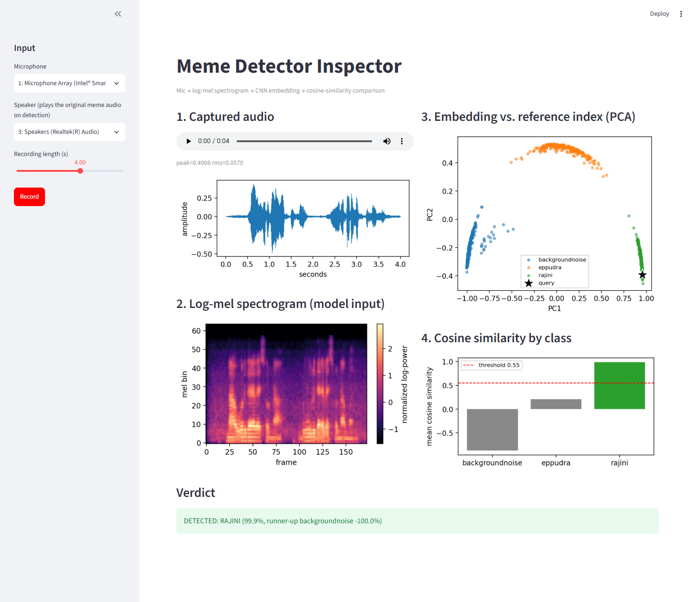
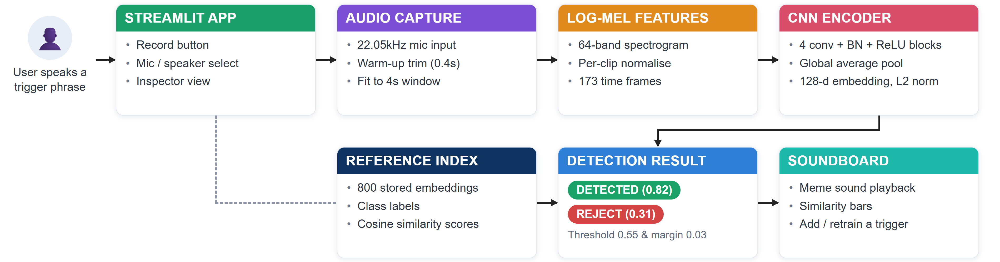
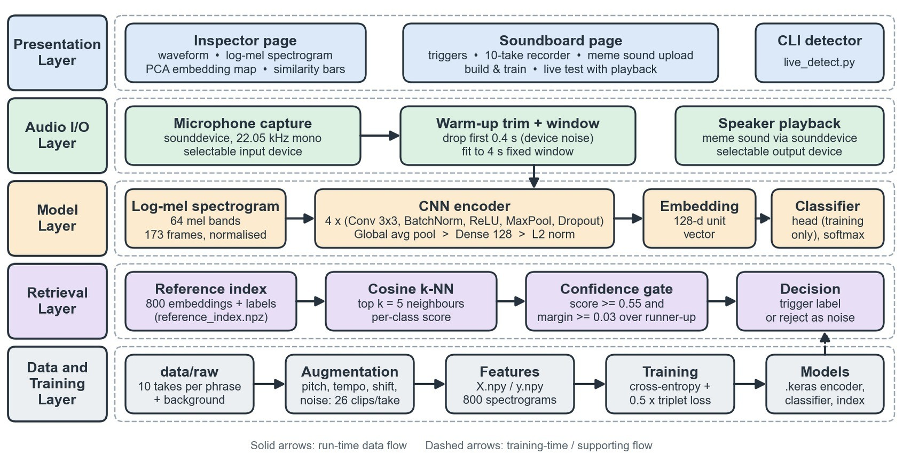
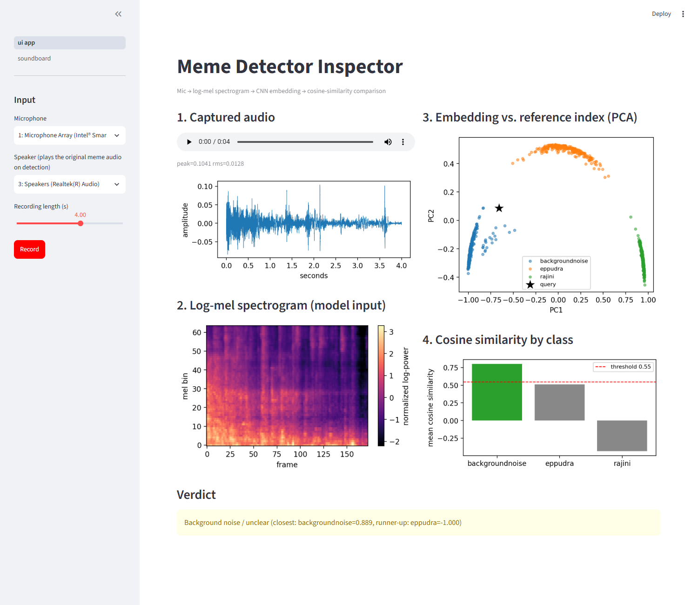
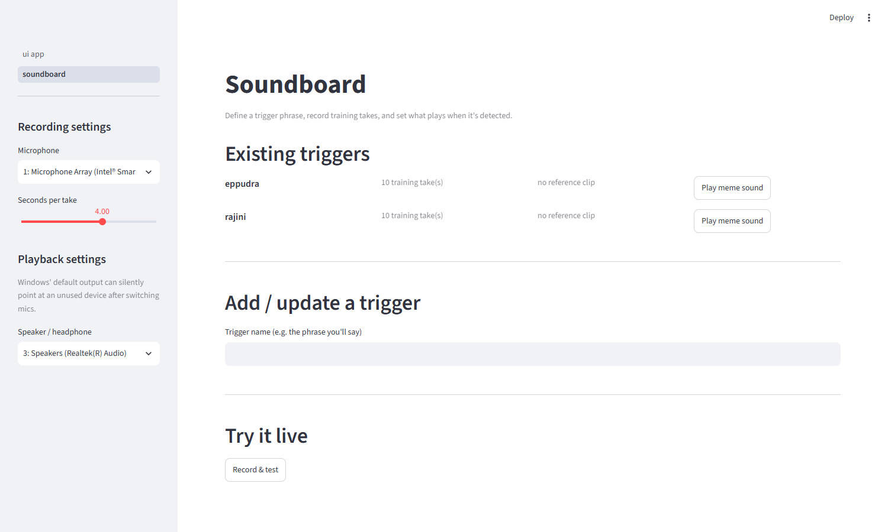
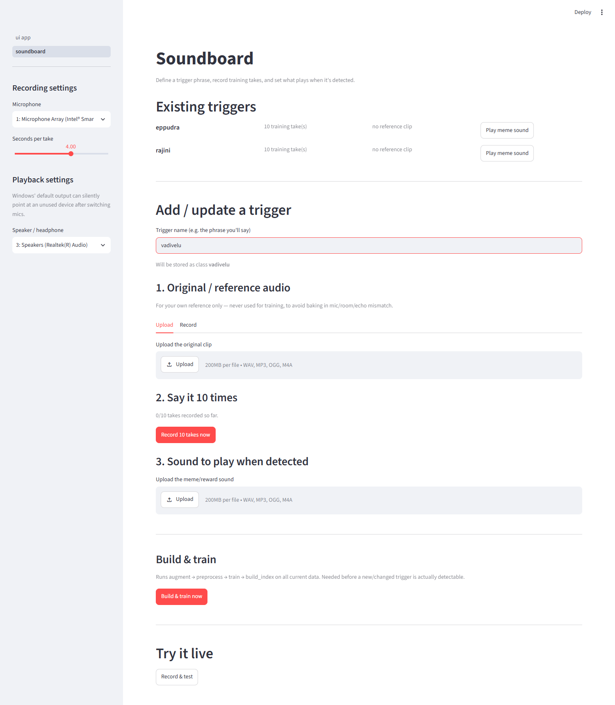

# MemeBot — Voice-Triggered Meme Soundboard

Say a trigger phrase into your microphone and MemeBot plays the matching meme sound.

It recognises short spoken phrases (currently the Tamil triggers **"eppudra"** and a **Rajini dialogue**) using a CNN that turns audio into embeddings, then compares each new recording against stored examples. It needs only about **10 recordings per phrase**, runs on a laptop CPU, and stays silent when it hears something it doesn't recognise.



*The Inspector page: a recorded rajini take goes through every stage of the pipeline and is detected at 99.9% similarity.*

> Applied Deep Learning (PBL) project — B.E. CSE (AI & ML), Chennai Institute of Technology.
> Dhakshan L (24AM0025) · Pragyasree K (24AM0079)

---

## Contents

- [Features](#features)
- [How it works](#how-it-works)
- [The app](#the-app)
- [Results](#results)
- [Getting started](#getting-started)
- [Adding your own trigger](#adding-your-own-trigger)
- [Project structure](#project-structure)
- [Configuration](#configuration)
- [Troubleshooting](#troubleshooting)
- [Limitations and future work](#limitations-and-future-work)

---

## Features

- **Learns from 10 recordings per phrase.** Augmentation turns each take into 26 training clips.
- **Says "I don't know".** A recording is only accepted when it is clearly closer to one trigger than to anything else. Room noise, unrelated speech and silence are rejected instead of being forced into a class.
- **Add triggers without code.** The Soundboard page records 10 takes, stores the meme sound, and retrains the model with one click.
- **See inside the model.** The Inspector page shows the waveform, spectrogram, where the recording lands among known examples, and the score for every class.
- **Handles real microphones.** It trims start-up noise some USB audio adapters produce, and lets you choose the microphone and speaker separately.
- **Runs offline.** No cloud speech API; everything runs locally on CPU.

---

## How it works



### 1. From audio to a spectrogram

Every clip is converted to mono at 22.05 kHz and fitted to a fixed **4-second window**. It then becomes a **64-band log-mel spectrogram** (64 × 173), normalised per clip. A spectrogram keeps both *when* and *at what pitch* sound happens, which is what separates one phrase from another.

### 2. Augmentation: 10 takes become 260 clips

A deep network can't learn from 10 recordings, so [augment.py](src/augment.py) creates 25 variants of each take plus the original. It applies, at random:

- pitch shift (±2 semitones)
- time stretch (0.85–1.15×)
- **placement inside a real background recording** at a random position and loudness
- added noise (10–30 dB signal-to-noise)

The background placement matters. Live recordings are always 4 seconds of real room sound with the phrase somewhere inside. Without it, the short "eppudra" clips were only ever seen padded with synthetic hiss, the model learned the padding instead of the word, and almost every live recording was classified as rajini.

Long background recordings are cut into 20 random 4-second crops each. Short clips are padded with low-level noise rather than digital silence, because a real microphone never records exact zero.

### 3. The CNN encoder

[model.py](src/model.py) defines a small CNN with **258,563 parameters**:

```
log-mel (64 × 173 × 1)
 → 4 × [Conv 3×3 → BatchNorm → ReLU → MaxPool 2×2 → SpatialDropout 0.15]   (32, 64, 128, 128 filters)
 → Global average pooling
 → Dense 128 → L2 normalisation   = 128-d embedding
 → Dense softmax head              (used only during training)
```

It is trained with **two losses at once** ([train.py](src/train.py)):

| Loss | Weight | Why |
|---|---|---|
| Softmax cross-entropy | 1.0 | A stable learning signal, even with a small dataset |
| Batch-hard triplet loss (margin 0.3) | 0.5 | Pulls clips of the same phrase together and pushes different phrases apart, so distance in embedding space means something |

Training uses Adam (learning rate 1e-3), batch size 32, up to 60 epochs, a stratified 80/20 split, early stopping on validation accuracy and learning-rate reduction on plateau.

### 4. Recognition by similarity, not classification

At run time the classifier head is ignored. The new recording's embedding is compared by **cosine similarity** against a **reference index** of all 800 training embeddings ([build_index.py](src/build_index.py)):

1. Find the 5 most similar stored clips.
2. Score each class by the average similarity of its clips among those 5. A class with none of them in the top 5 scores −1.0, which appears as −100% in the app.
3. **Accept** only if the best class is a trigger (not `backgroundnoise`), its score is **≥ 0.55**, and it beats the runner-up by **≥ 0.03**.
4. On acceptance, play `data/meme_sounds/<trigger>.*`. Otherwise, report "background noise / unclear" and stay silent.

### Architecture



---

## The app

Run `streamlit run ui_app.py` from `src/`. The app has two pages.

### Inspector: see why a recording was accepted or rejected

Pick a microphone and speaker, press **Record**, and every stage is shown:

1. **Captured audio**: playback, peak/RMS level (with a warning if the mic is too quiet), and the waveform
2. **Log-mel spectrogram**: exactly what the model sees
3. **Embedding map**: the 800 stored clips projected to 2-D with PCA, with your recording as a ★
4. **Similarity by class**: one bar per class, with the 0.55 threshold drawn
5. **Verdict**: detected (and the meme sound plays) or rejected

| Detected: a recorded rajini take | Rejected: the real microphone, nobody speaking |
|---|---|
|  |  |
| The ★ lands inside the green rajini cluster; similarity 0.999. | The ★ lands near the blue background cluster; verdict is "background noise", so nothing plays. |

> **How these screenshots were made:** the right-hand one is a real recording from the laptop microphone of a quiet room. For the left-hand one the microphone input was replaced with `data/raw/rajini/rajini_1.ogg`, one of the training takes, so it shows the success path rather than performance on unseen speech. Playback was muted for both.

### Soundboard: manage triggers without code



The page lists every trigger with its number of training takes and a button to play its meme sound. Below that you can add a new trigger, and **Try it live** records a clip and plays the matching sound on a confident detection.

Typing a trigger name opens a three-step flow:



1. **Original / reference audio**: upload or record the clip you're imitating. It is stored in `data/reference/` and **never used for training**, because a movie clip with music or echo would teach the model the wrong recording conditions.
2. **Say it 10 times**: a guided recorder saves 10 takes to `data/raw/<trigger>/`.
3. **Sound to play when detected**: upload the meme sound, stored as `data/meme_sounds/<trigger>.*`.

**Build & train now** then runs the full pipeline and reloads the model.

---

## Results

Measured on the current models in `models/`:

| | |
|---|---|
| Classes | `backgroundnoise`, `eppudra`, `rajini` |
| Raw recordings | 11 background, 10 eppudra, 10 rajini |
| Training clips after augmentation | 280 / 260 / 260 = **800** |
| Train / validation split | 640 / 160 (stratified) |
| Model size | 258,563 parameters (CPU-friendly) |
| Validation accuracy | 100% (see caveat) |

**How well separated the classes are** (average cosine similarity between stored embeddings; 1 = identical, −1 = opposite):

| | backgroundnoise | eppudra | rajini |
|---|---|---|---|
| **backgroundnoise** | **0.962** | 0.163 | −0.815 |
| **eppudra** | 0.163 | **0.942** | 0.324 |
| **rajini** | −0.815 | 0.324 | **0.991** |

Clips of the same class sit very close together (0.94–0.99), and every pair of different classes stays at 0.32 or below.

> **Caveat:** the 100% validation accuracy is optimistic. The 26 augmented copies of each recording are split randomly, so the validation set contains near-copies of training clips. A fair test needs new recordings made on a different day or microphone and kept out of training entirely. In live testing, results depended heavily on the microphone (see [Troubleshooting](#troubleshooting)).

---

## Getting started

### Requirements

- Python 3.10+ (developed on 3.13, Windows 11)
- A microphone and speakers or headphones

```bash
git clone https://github.com/dhakshanl/memebot.git
cd memebot
pip install tensorflow keras librosa soundfile sounddevice scikit-learn numpy matplotlib streamlit
```

Developed with TensorFlow 2.20, Keras 3.13, librosa 0.11, scikit-learn 1.8 and Streamlit 1.62.

### Run the app

Trained models are included in `models/`, so you can start detecting immediately:

```bash
cd src
streamlit run ui_app.py
```

Open http://localhost:8501. The sidebar switches between the **Inspector** (`ui app`) and **Soundboard** pages.

### Command-line detector

```bash
cd src
python live_detect.py            # uses the Windows default mic and speaker
python live_detect.py "AB13X"    # or pick a device by (part of) its name, or its index
```

Press Enter, speak within 4 seconds, and the detector prints the result and plays the meme sound on a match.

### Retrain from scratch

Only needed when `data/raw/` changes. Run in order from `src/`:

```bash
python augment.py        # data/raw       → data/augmented   (800 clips)
python preprocess.py     # data/augmented → X.npy / y.npy
python train.py          # → models/embedding_model.keras, models/classifier_model.keras
python build_index.py    # → models/reference_index.npz
```

The Soundboard's **Build & train now** button runs the same four steps.

---

## Adding your own trigger

1. Open the **Soundboard** page and type the trigger name.
2. Record **10 takes** in the conditions you'll actually use: the same microphone, room and speaking pace.
3. Upload the meme sound to play.
4. Click **Build & train now**, then test it under **Try it live**.

Classes are read from the folders in `data/raw/`, so no code changes are needed.

**Tips for reliable detection**

- Record the takes with the **same microphone** you'll use live. Device mismatch was the biggest cause of failures during development.
- Avoid echoey rooms, or record in the same room you'll use the soundboard in.
- Short, consistently timed phrases work best. A long dialogue whose length varies from take to take gets cropped or padded differently in the 4-second window.

---

## Project structure

```
memebot/
├── src/
│   ├── config.py         paths, audio settings, class list (scanned from data/raw/)
│   ├── augment.py        raw takes → 4 s augmented clips (pitch, tempo, background placement, noise)
│   ├── preprocess.py     clips → normalised log-mel spectrograms (X.npy / y.npy)
│   ├── model.py          CNN encoder, classifier head, batch-hard triplet loss
│   ├── train.py          joint cross-entropy + triplet training
│   ├── build_index.py    embeds every clip → reference_index.npz
│   ├── live_detect.py    recording, retrieval, confidence check, playback (also a CLI)
│   ├── ui_app.py         Streamlit Inspector page
│   └── pages/
│       └── soundboard.py Streamlit Soundboard page
├── data/
│   ├── raw/<class>/      your recordings (the only training input)
│   ├── augmented/        generated, git-ignored
│   ├── reference/        "what to say" clips, never trained on
│   └── meme_sounds/      <class>.wav played on detection
├── models/               trained encoder, classifier and reference index
└── docs/                 diagrams and screenshots used in this README
```

---

## Configuration

| Setting | Where | Default | Effect |
|---|---|---|---|
| `DURATION` | [config.py](src/config.py) | 4.0 s | Length of every clip window |
| `N_MELS` | [config.py](src/config.py) | 64 | Mel bands in the spectrogram |
| `EMBEDDING_DIM` | [config.py](src/config.py) | 128 | Embedding size |
| `SIMILARITY_THRESHOLD` | [live_detect.py](src/live_detect.py) | 0.55 | Minimum score to accept a trigger |
| `MARGIN_THRESHOLD` | [live_detect.py](src/live_detect.py) | 0.03 | How far the winner must beat the runner-up |
| `TOP_K` | [live_detect.py](src/live_detect.py) | 5 | Neighbours used in retrieval |
| `WARMUP_SECONDS` | [live_detect.py](src/live_detect.py) | 0.4 s | Start of each recording discarded as device noise |
| `VARIANTS_PER_FILE` | [augment.py](src/augment.py) | 25 | Augmented copies per short take |

Raise the threshold or margin for fewer false triggers; lower them if real triggers are being missed. If you change `DURATION` or `N_MELS`, retrain from scratch.

---

## Troubleshooting

**Everything is detected as "background noise".**
Check the level in Inspector step 1. A *very quiet* warning means the wrong microphone or a low input gain. Some USB adapters (we hit this with an AB13X dongle) also add a noise burst when recording starts; the 0.4 s trim handles most of it, but switching to a different headset fixed the rest.

**It detects, but no sound plays.**
Windows' default output can point at a device you aren't listening to. Pick your headphones explicitly in the sidebar's speaker selector, or pass the device name to `live_detect.py`. Also check that `data/meme_sounds/<trigger>.*` exists.

**One trigger is detected much less reliably than another.**
Compare the training takes to how you speak live. In this project the rajini takes had room echo and varied from 2.6 to 5.3 s in length, while eppudra was a consistent 1.1–1.6 s. Re-recording the weaker trigger under live conditions is the most effective fix.

---

## Limitations and future work

- **Small, single-speaker dataset.** Accuracy on other speakers, rooms and microphones is unmeasured. Next steps are recording across several days and devices and keeping whole recordings out of training as a test set.
- **Push-to-record.** Detection runs on 4-second recordings started with a button; continuous listening with a sliding window would make it hands-free.
- **Fixed 4-second window.** It crops long dialogues and pads short words; voice activity detection or variable-length input would help.
- **Fixed thresholds.** 0.55 / 0.03 are hand-picked; per-class thresholds tuned on held-out data would be more principled.
- **Echo and device robustness.** Augmenting with room and microphone responses would reduce sensitivity to recording conditions.
